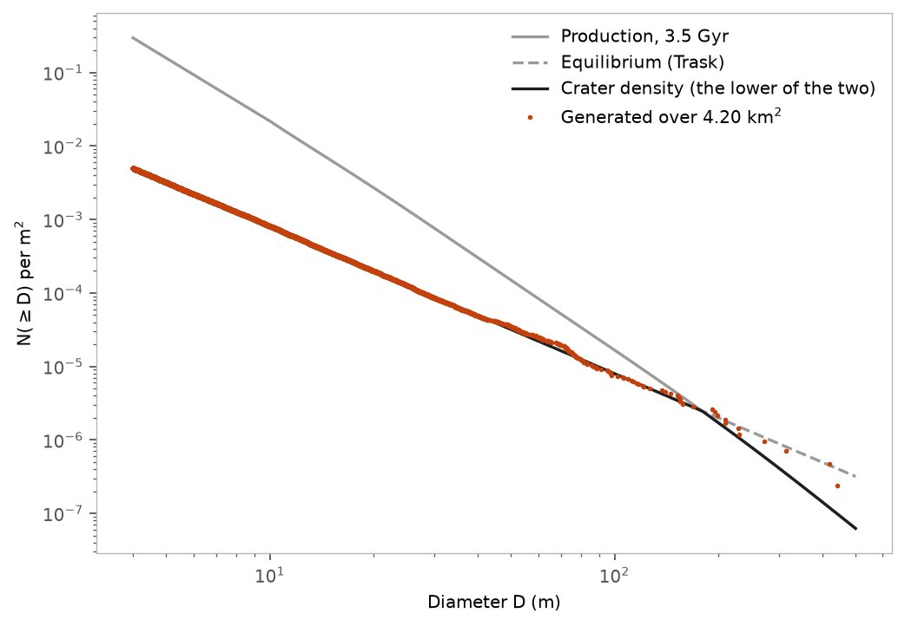
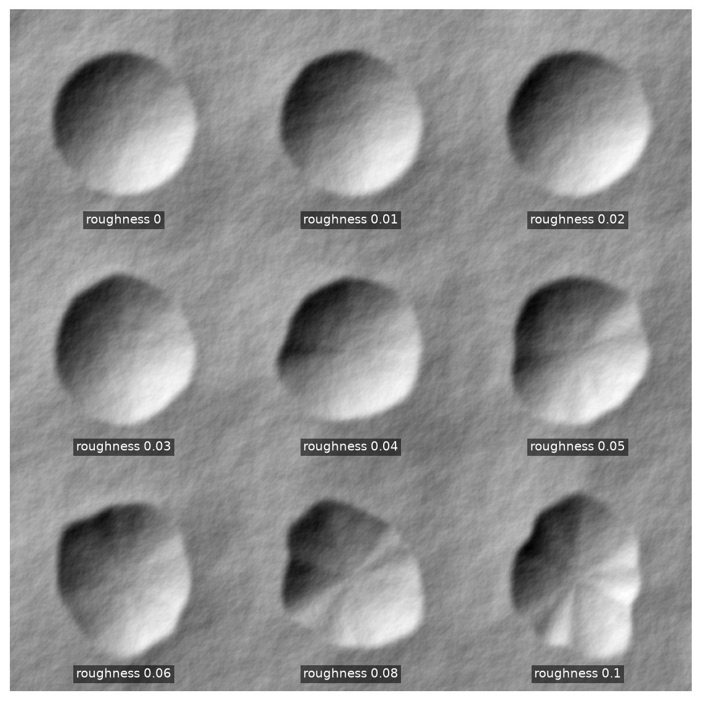
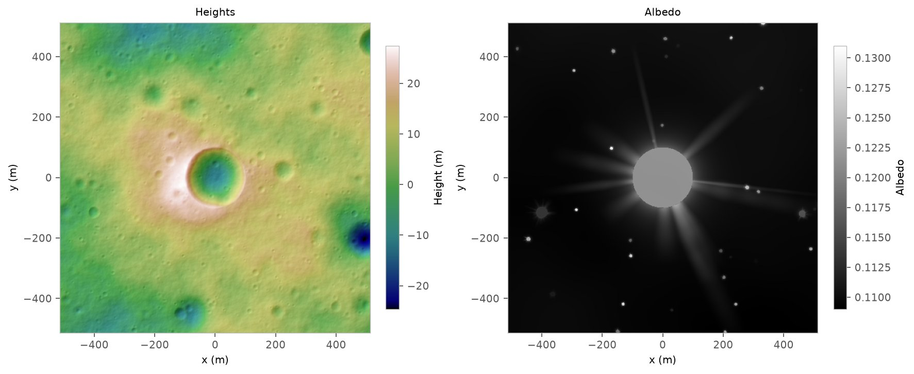

# Craters and boulders

A `CraterLayer` draws a crater population from a size-frequency distribution, gives each crater an
age, and cuts it into the terrain with a profile that degrades with that age.

## A crater layer

With no arguments, a crater layer takes the default lunar models: a 3.5 Gyr surface capped at the
Hartmann equilibrium, diffusion degradation matched to the crater ages, and the Martin, Parkes and
Dunstan profile, with irregular outlines.

=== "Python"

    ```python
    --8<-- "docs/snippets/craters/crater_layer.py:default_layer"
    ```

=== "C++"

    ```cpp
    --8<-- "docs/snippets/craters/crater_layer.cpp:default_layer"
    ```

## Published models

Each model can be chosen on its own. Here the density and ages come from one equilibrium surface: the
extended Neukum production function over 3.5 Gyr, capped by the Trask equilibrium.

=== "Python"

    ```python
    --8<-- "docs/snippets/craters/crater_layer.py:published_models"
    ```

=== "C++"

    ```cpp
    --8<-- "docs/snippets/craters/crater_layer.cpp:published_models"
    ```

Production outpaces equilibrium below a couple of hundred meters, so small craters stay at the
equilibrium density while large ones follow production.

<figure markdown>



<figcaption>Generated craters follow the density, the lower of production and equilibrium.</figcaption>

</figure>

??? example "Reproduce this figure"

    ```python
    --8<-- "docs/gallery/craters/size_frequency.py"
    ```

## Degradation

The degradation model wears craters down with their age: not at all, shallower in proportion to age,
or by topographic diffusion.

<figure markdown>


<figcaption>Nine identical 150 m craters from 1 Myr to 1.5 Gyr old, under the default degradation.</figcaption>

</figure>

??? example "Reproduce this figure"

    ```python
    --8<-- "docs/gallery/craters/degradation_by_age.py"
    ```

Freshness degradation instead sets each crater's depth from its freshness, its depth over its fresh
depth, whatever its size; Martin, Parkes and Dunstan's profile lowers and rounds the rim with it.

<figure markdown>


<figcaption>The same craters from freshness 1 to 0.2, under freshness degradation.</figcaption>

</figure>

??? example "Reproduce this figure"

    ```python
    --8<-- "docs/gallery/craters/degradation_by_freshness.py"
    ```

<figure markdown>


<figcaption>The same craters under each degradation model.</figcaption>

</figure>

??? example "Reproduce this figure"

    ```python
    --8<-- "docs/gallery/craters/degradation.py"
    ```

## Irregular outlines

Rims can be roughened by random harmonics, set by their RMS deviation from a circle in radii, and
some craters stretched into ellipses.

<figure markdown>



<figcaption>The same young craters with rim roughness from 0 to 0.1 radii.</figcaption>

</figure>

??? example "Reproduce this figure"

    ```python
    --8<-- "docs/gallery/craters/irregularity.py"
    ```

## Heights and albedo

Crater layers also feed the albedo: ejecta and rays are bright when a crater is young and fade as it
ages.

<figure markdown>



<figcaption>Heights, and the albedo of the same craters with a young crater at the center.</figcaption>

</figure>

??? example "Reproduce this figure"

    ```python
    --8<-- "docs/gallery/craters/heights_and_albedo.py"
    ```

## The crater list

Every crater a layer places, with its position, diameter, depth and age, can be read back or written
to CSV or JSON.

=== "Python"

    ```python
    --8<-- "docs/snippets/craters/crater_layer.py:crater_list"
    ```

=== "C++"

    ```cpp
    --8<-- "docs/snippets/craters/crater_layer.cpp:crater_list"
    ```
