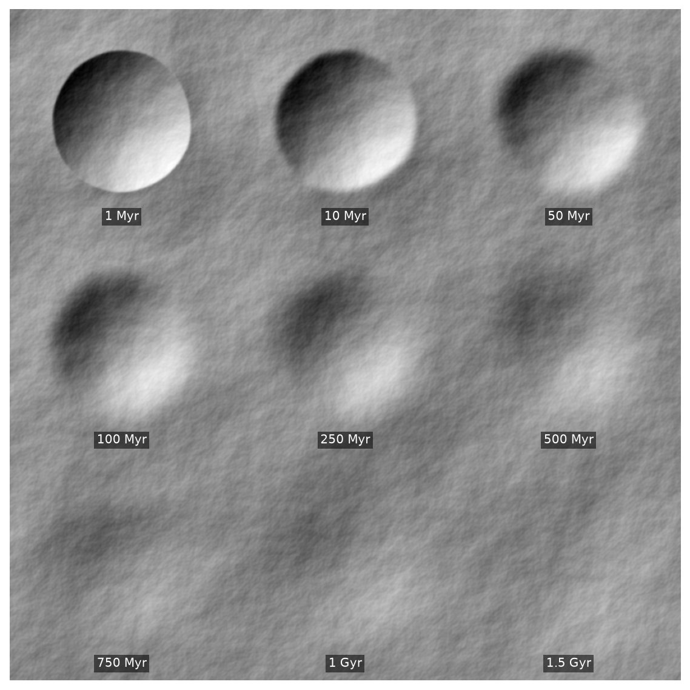
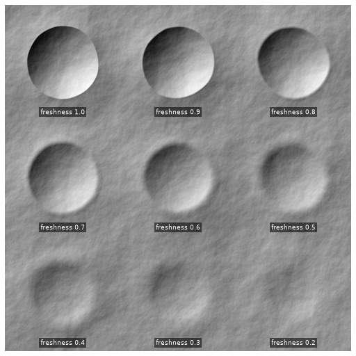
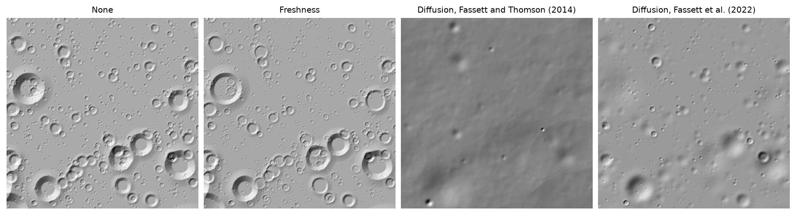

# Crater degradation

The degradation model wears craters down with their age: not at all, shallower in proportion to age,
or by topographic diffusion.

<figure markdown>



<figcaption>Nine identical 150 m craters from 1 Myr to 1.5 Gyr old, under the default degradation.</figcaption>

</figure>

??? example "Reproduce this figure"

    ```python
    --8<-- "docs/gallery/craters/degradation_by_age.py"
    ```

Freshness degradation instead sets each crater's depth from its freshness, its depth over its fresh
depth, whatever its size; Martin, Parkes and Dunstan's profile lowers and rounds the rim with it.

<figure markdown>



<figcaption>The same craters from freshness 1 to 0.2, under freshness degradation.</figcaption>

</figure>

??? example "Reproduce this figure"

    ```python
    --8<-- "docs/gallery/craters/degradation_by_freshness.py"
    ```

<figure markdown>



<figcaption>The same craters under each degradation model.</figcaption>

</figure>

??? example "Reproduce this figure"

    ```python
    --8<-- "docs/gallery/craters/degradation.py"
    ```
