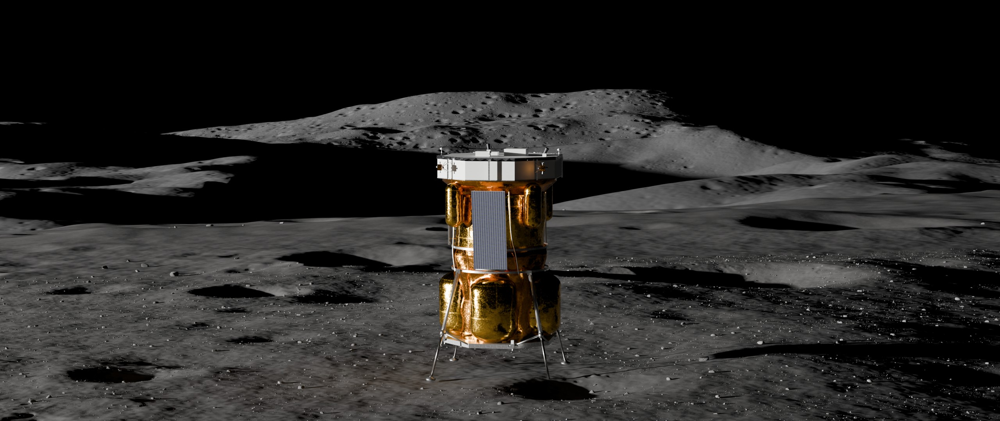
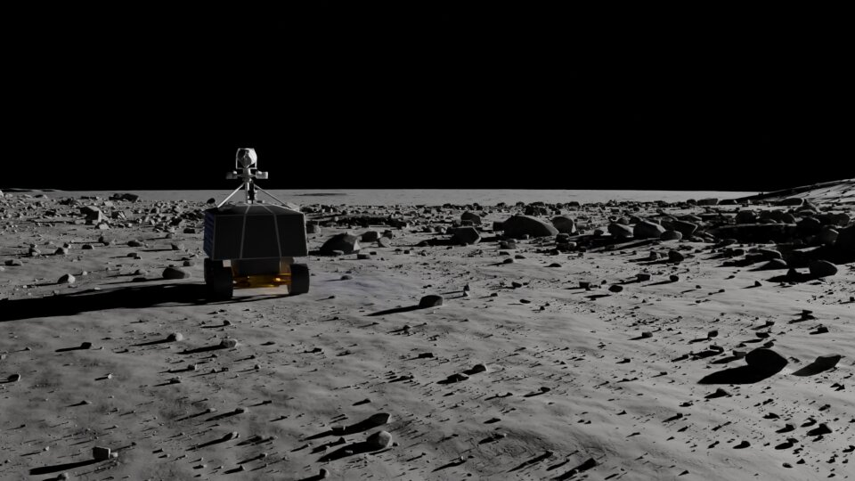
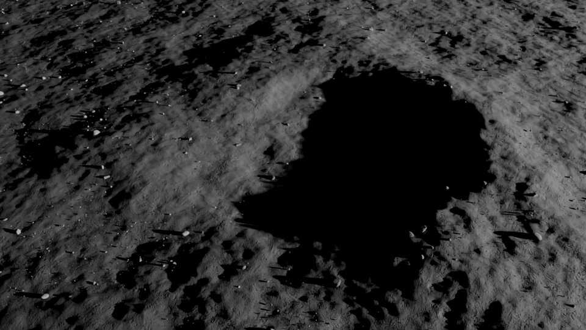
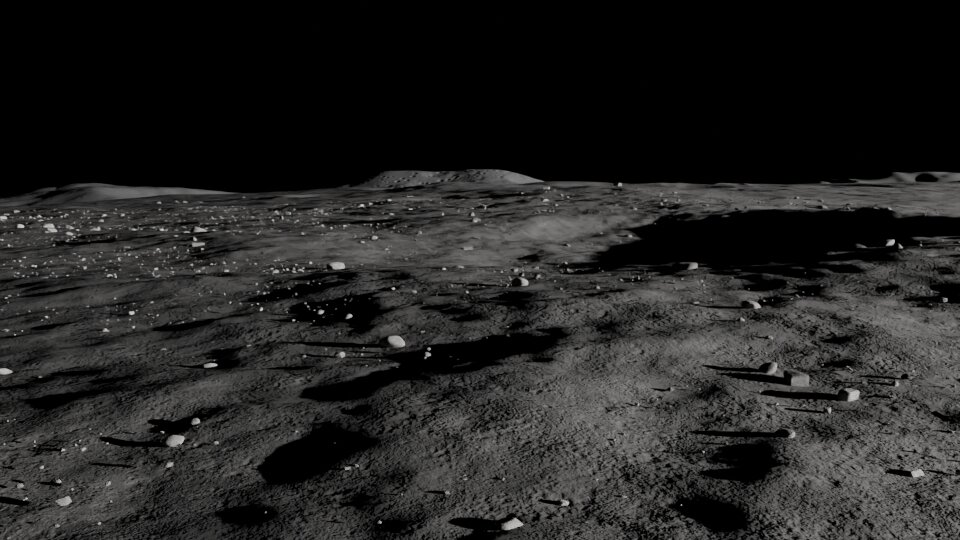

# Gallery

Renders of terrain made with TerrainGen. Click one to enlarge it.

<figure class="tg-gallery__wide" markdown>

{ data-gallery="hero" data-title="Connecting Ridge" data-description="Blue Moon MK1 on TerrainGen's upscaled terrain, with Mons Malapert in the background." }

<figcaption markdown="span">**Connecting Ridge.** Blue Moon MK1 on TerrainGen's upscaled terrain at Connecting Ridge, with Mons Malapert in the background.</figcaption>

</figure>

<figure markdown>

{ data-gallery="hero" data-title="CP-21 at the Gruithuisen Domes" data-description="A VIPER rover on Mons Gruithuisen Gamma, on the LROC NAC 2 m DTM upscaled by TerrainGen." }

<figcaption markdown="span">**CP-21 at the Gruithuisen Domes.** A VIPER rover on Mons Gruithuisen Gamma at the CP-21 landing site, on the LROC NAC 2 m DTM upscaled by TerrainGen with dense boulder fields.</figcaption>

</figure>

<figure markdown>

{ data-gallery="hero" data-title="Connecting Ridge crater" data-description="A crater on TerrainGen's upscaled Connecting Ridge terrain, seen from above at a low sun." }

<figcaption markdown="span">**Connecting Ridge crater.** A crater on TerrainGen's upscaled Connecting Ridge terrain seen from above, its floor in shadow under the low south polar sun.</figcaption>

</figure>

<figure markdown>

{ data-gallery="hero" data-title="Connecting Ridge from the ground" data-description="TerrainGen's upscaled Connecting Ridge terrain from just above the ground." }

<figcaption markdown="span">**Connecting Ridge from the ground.** TerrainGen's upscaled Connecting Ridge terrain from just above the ground, with boulders and small craters in front and hills on the horizon.</figcaption>

</figure>

