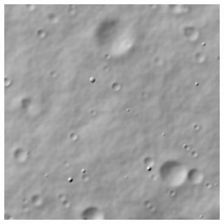
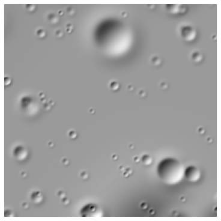
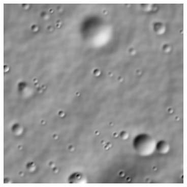
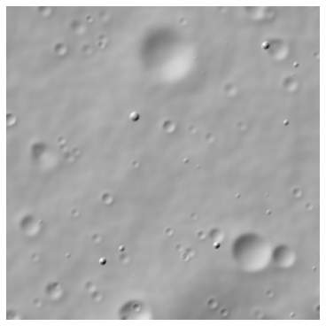
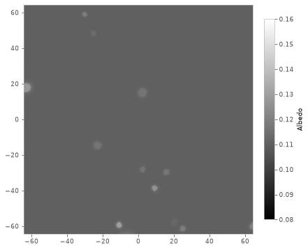

# Quickstart

This page makes a first terrain in two ways, from a configuration file on the command line and one layer at a time from Python or C++. Every example on it is run as a test, and every image is made by the code above it.

Install the Python package, which also installs the `terraingen` command. See [Installation](installation.md) for releases and building from source.

```sh
pip install terraingenpy
```

## From the command line

A configuration is JSON that describes a terrain's layers, applied in order, and the files to write. This one lays fractal noise, craters and boulders over a 128 m square and writes a GeoTIFF of the heights at 0.5 m and a list of the craters.

```json title="config.json"
--8<-- "docs/snippets/_quickstart/config.json"
```

Generate it from the command line.

```sh
terraingen config.json
```

<figure markdown>



<figcaption>Noise, craters and boulders on 128 m at 0.5 m in terrain.tif, hillshaded.</figcaption>

</figure>

Python runs the same file without the command.

```py
--8<-- "docs/snippets/_quickstart/run-a-config.py:run_a_config"
```

The [configuration reference](../reference/index.md) lists every layer and output and their settings.

## From Python or C++

The same terrain can be built from library objects, one layer at a time. Python needs only `import terraingen`; C++ includes `terraingen/terraingen.h` and links `terraingen::terraingen`.

### Craters on a flat source

A terrain generator is a source of starting heights and layers applied over it. Here the source is flat, 257 x 257 cells of 0.5 m, and one crater layer draws craters from the lunar production function, aged and worn.

=== "Python"

    ```py
    --8<-- "docs/snippets/_quickstart/add-craters.py:add_craters"
    ```

=== "C++"

    ```cpp
    --8<-- "docs/snippets/_quickstart/add-craters.cpp:add_craters"
    ```

<figure markdown>



<figcaption>Craters drawn from the lunar production function, hillshaded.</figcaption>

</figure>

### Noise beneath the craters

Layers apply in order, each on the heights before it, so noise placed first lies beneath the craters.

=== "Python"

    ```py
    --8<-- "docs/snippets/_quickstart/add-noise.py:add_noise"
    ```

=== "C++"

    ```cpp
    --8<-- "docs/snippets/_quickstart/add-noise.cpp:add_noise"
    ```

<figure markdown>



<figcaption>Fractal noise 2 m high, then the craters, hillshaded.</figcaption>

</figure>

### Boulders

A boulder layer scatters boulders between the craters and, given the crater layer, throws ejecta blocks around them. Boulders smaller than a cell are left out of the heights, and the largest can be written as 3D models instead.

=== "Python"

    ```py
    --8<-- "docs/snippets/_quickstart/add-boulders.py:add_boulders"
    ```

=== "C++"

    ```cpp
    --8<-- "docs/snippets/_quickstart/add-boulders.cpp:add_boulders"
    ```

<figure markdown>



<figcaption>Boulders drawn into the heights, hillshaded; most are smaller than a cell.</figcaption>

</figure>

### Albedo

An albedo is a source of reflectance changed by albedo layers. Here a synthetic base of mature soil is brightened around fresh craters, which fade as they age. It reads the crater layer, not the heights, so it needs no evaluation.

=== "Python"

    ```py
    --8<-- "docs/snippets/_quickstart/add-albedo.py:add_albedo"
    ```

=== "C++"

    ```cpp
    --8<-- "docs/snippets/_quickstart/add-albedo.cpp:add_albedo"
    ```

<figure markdown>



<figcaption>In the albedo, fresh craters and their ejecta are brighter than the mature soil around them.</figcaption>

</figure>

### Write the outputs

Write the heights as a GeoTIFF, and the craters and boulders the layers placed as lists.

=== "Python"

    ```py
    --8<-- "docs/snippets/_quickstart/write-outputs.py:write_outputs"
    ```

=== "C++"

    ```cpp
    --8<-- "docs/snippets/_quickstart/write-outputs.cpp:write_outputs"
    ```

## Next

- [Guides](../guides/index.md) cover the command line and GUI, and short examples of single tasks, such as listing craters or writing boulder models straight from a configuration.
- [Gallery](../gallery/index.md) shows what each setting does, with the code that made each figure.
- [Concepts](../concepts/index.md) explains how TerrainGen is designed.
