# Customize TerrainGen

Every part of a TerrainGen terrain is an object you can replace with your own. That covers the starting heights, the relief over them and how coarse heights are refined. It covers how many craters there are, how old they are, their shape and how they wear. It also covers where features gather, the albedo and the rocks boulders are made of. Your parts work exactly like the built-in ones. They join the same terrains, are listed and queried the same way, and evaluate over any grid or at single points.

This guide walks through each kind of part, from combining built-in parts to writing your own, in Python and C++. Every example is run as a test, and every image is made by the code above it. Each step is also a task under [Customization](../customization.md).

| To change | Subclass | Implement |
| --- | --- | --- |
| [The starting heights](#sources) | `Source` | the grid it covers and the height at a point |
| [The relief over them](#layers) | `Layer` (`FormulaLayer` in C++) | the height at a point from the height before it |
| [How posts are refined](#upsamplers) | `Upsampler` | the height at a point from the posts around it |
| [How many craters or boulders there are](#size-frequency-distributions) | `SizeFrequencyDistribution` | the cumulative count N(>= D) |
| [How old craters are](#crater-age-models) | `CraterAgeModel` | the lifetime by diameter, and optionally how ages are drawn |
| [The shape of a crater](#crater-profiles) | `CraterProfile` | the height by distance from the center, and its reach |
| [How craters wear](#degradation-models) | `DegradationModel` | each crater's fresh and current depth and rim |
| [Where craters and boulders gather](#surface-fields) | `SurfaceField` | the value at a point and the largest value |
| [The starting albedo](#albedo-sources) | `AlbedoSource` | the number of bands and the value at a point |
| [Changes to the albedo](#albedo-layers) | `AlbedoLayer` | the value at a point from the value before it |
| [The shape of a boulder](#rock-meshes) | none, a list of meshes | the meshes, read with `read_mesh` |

## Compose built-in parts

Before writing anything, many terrains are a matter of combining what is built in. A noise layer adds a stack of fractals, each with its own seed, wavelength, amplitude, octaves and type. Here broad fBm hills come first and finer ridged noise goes on top.

=== "Python"

    ```py
    --8<-- "docs/snippets/customization/stack-noise-fractals.py:stack_noise_fractals"
    ```

=== "C++"

    ```cpp
    --8<-- "docs/snippets/customization/stack-noise-fractals.cpp:stack_noise_fractals"
    ```

<figure markdown>

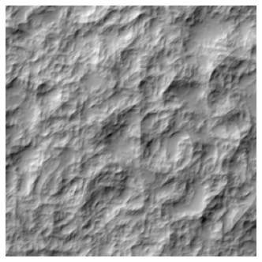

<figcaption>Broad fBm hills with finer ridged noise on top, hillshaded.</figcaption>

</figure>

## Sources

A source gives a terrain's starting heights. It defines the grid it covers and the height at any point and sample spacing. It can be an analytic surface, a DEM in a format of your own or the ground of another simulation. Layers are laid over it as over a GeoTIFF. Here a Gaussian dome takes craters.

=== "Python"

    ```py
    --8<-- "docs/snippets/customization/write-a-source.py:write_a_source"
    ```

=== "C++"

    ```cpp
    --8<-- "docs/snippets/customization/write-a-source.cpp:write_a_source"
    ```

<figure markdown>

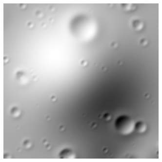

<figcaption>Craters on the dome, hillshaded.</figcaption>

</figure>

`fill(heights, spacing, threads)` is optional and fills a whole grid at once, for a source that can do that faster than point by point. `resolution_at(x, y)` tells crater and boulder layers which features the source already resolves, so they add only the smaller ones. `post_spacing_at(x, y)` gives the spacing of the posts behind each height, measured or generated, which roughness estimates sample the source at.

## Layers

A layer changes the heights beneath it. One whose height at a point depends only on the height there and the point implements `apply_at` in Python, or derives from `FormulaLayer` in C++, and is then evaluated over grids and at points like the built-in layers. Layers after it are laid over what it makes, so here craters fall on ridges.

=== "Python"

    ```py
    --8<-- "docs/snippets/customization/write-a-layer.py:write_a_layer"
    ```

=== "C++"

    ```cpp
    --8<-- "docs/snippets/customization/write-a-layer.cpp:write_a_layer"
    ```

<figure markdown>

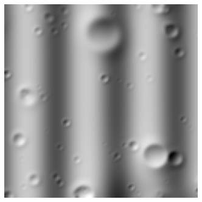

<figcaption>Craters laid over the ridges, hillshaded.</figcaption>

</figure>

A quick change needs no class at all. [`FunctionLayer`](../../api/python.md#terraingen.FunctionLayer) turns a function of the point, the sample spacing and the height so far into a layer, a Python function or a C++ lambda.

A layer that needs more than one point at a time, such as a filter over its neighbors, implements `apply(heights, context)` in Python, changing a raster in place, or `ApplySamples` on `Layer` in C++.

## Upsamplers

An upsampler decides a source's heights between its posts and below their spacing, as cubic interpolation or diamond-square refinement do. Registered under a name, configurations use it like the built-in ones, as a source's `"upsampling"`, so a custom part can be chosen from JSON without changing any code that reads the configuration. Here it holds the nearest post's height, rounded down to 2 m terraces.

=== "Python"

    ```py
    --8<-- "docs/snippets/customization/write-an-upsampler.py:write_an_upsampler"
    ```

=== "C++"

    ```cpp
    --8<-- "docs/snippets/customization/write-an-upsampler.cpp:write_an_upsampler"
    ```

<figure markdown>

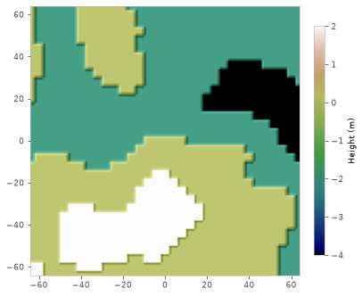

<figcaption>Heights refined from 4 m posts onto 1 m cells, as 2 m terraces.</figcaption>

</figure>

`reach()` is how many posts either side of a point the upsampler reads, so tiles read enough of their neighbors to join seamlessly. Settings given in the configuration are passed to the factory, in Python as keyword arguments and in C++ as JSON text.

## Size-frequency distributions

A size-frequency distribution gives how many craters or boulders there are of each size, as the cumulative count N(>= D) per square meter. Only the cumulative count is needed, since the incremental count and the inverse used to draw diameters are derived from it. Any crater layer or boulder layer takes it in place of a published distribution.

=== "Python"

    ```py
    --8<-- "docs/snippets/customization/write-a-size-distribution.py:write_a_size_distribution"
    ```

=== "C++"

    ```cpp
    --8<-- "docs/snippets/customization/write-a-size-distribution.cpp:write_a_size_distribution"
    ```

<figure markdown>

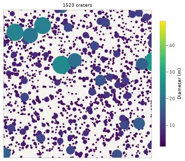

<figcaption>The craters it gives on 200 m, drawn to scale and colored by diameter.</figcaption>

</figure>

A crater layer is made of four models. They are this distribution, the ages, the degradation and the profile. The next three sections replace the other three.

## Crater age models

A crater age model gives how long craters of each size stay visible. It draws each crater's age within that lifetime, uniformly unless you say otherwise. Freshness degradation wears craters over the same lifetimes, so the ages also set how worn each crater is. Here small craters are erased quickly and large ones last, so small craters are always young.

=== "Python"

    ```py
    --8<-- "docs/snippets/customization/write-a-crater-age-model.py:write_a_crater_age_model"
    ```

=== "C++"

    ```cpp
    --8<-- "docs/snippets/customization/write-a-crater-age-model.cpp:write_a_crater_age_model"
    ```

<figure markdown>

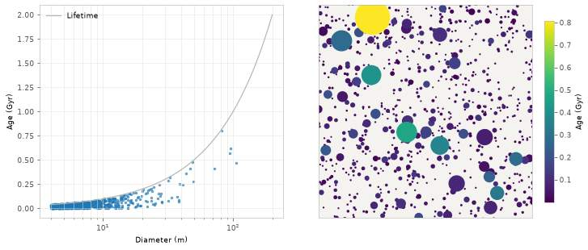

<figcaption>Each crater's age by its diameter, under the lifetime that grows with size (left), and the craters drawn to scale and colored by age (right).</figcaption>

</figure>

## Crater profiles

A crater profile gives a crater's height by distance from its center, shaped by its current depth and rim height as fractions of its diameter, which the degradation model sets. It also says how many radii from the center it reaches, so the layer knows which craters touch a point. Here a straight-walled cone replaces the default bowl of Martin, Parkes and Dunstan.

=== "Python"

    ```py
    --8<-- "docs/snippets/customization/write-a-crater-profile.py:write_a_crater_profile"
    ```

=== "C++"

    ```cpp
    --8<-- "docs/snippets/customization/write-a-crater-profile.cpp:write_a_crater_profile"
    ```

<figure markdown>

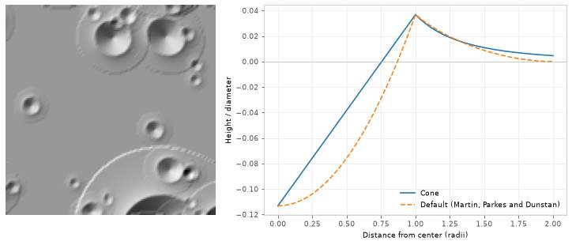

<figcaption>Cone-shaped craters, hillshaded (left), and a fresh 100 m crater's height over diameter with the cone and with the default profile of Martin, Parkes and Dunstan (right).</figcaption>

</figure>

On the GPU a profile of your own is tabulated per crater, so craters shaped by it are still drawn by the crater kernel.

## Degradation models

A degradation model gives each crater's depth and rim height, both fresh and now. It reads only the crater's diameter, age and ID. The profile shapes the crater to this state. Crater lists report it as each crater's depth ratio and freshness, so you can check it without evaluating any heights. Here craters lose half their depth and rim every Gyr.

=== "Python"

    ```py
    --8<-- "docs/snippets/customization/write-a-degradation-model.py:write_a_degradation_model"
    ```

=== "C++"

    ```cpp
    --8<-- "docs/snippets/customization/write-a-degradation-model.cpp:write_a_degradation_model"
    ```

<figure markdown>

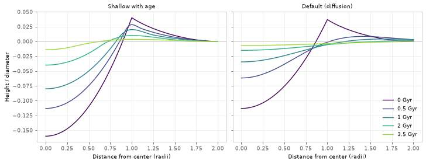

<figcaption>A 100 m crater's height over diameter as it ages on Martin, Parkes and Dunstan's profile, worn by the model, which halves its depth and rim every Gyr (left), and by the default diffusion degradation (right).</figcaption>

</figure>

## Surface fields

A surface field is a value that varies over the ground, read at any point. Crater and boulder layers take one as a density map. It scales their density point by point, or gives a count or covered share to match. The field also gives its largest value, which bounds how many features are drawn before thinning. Here a field clears craters from a landing pad and lets them back in around it.

=== "Python"

    ```py
    --8<-- "docs/snippets/customization/write-a-surface-field.py:write_a_surface_field"
    ```

=== "C++"

    ```cpp
    --8<-- "docs/snippets/customization/write-a-surface-field.cpp:write_a_surface_field"
    ```

<figure markdown>

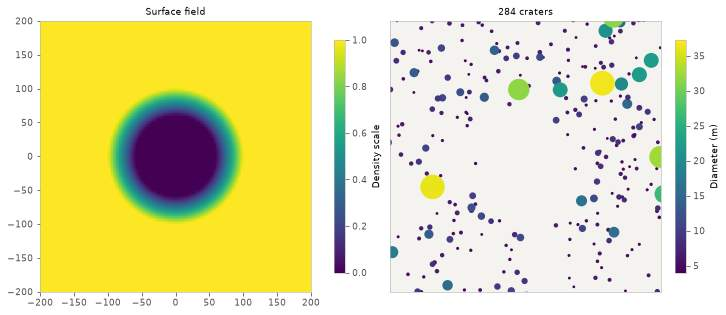

<figcaption>The field, a density scale of 0 on the landing pad rising to 1 beyond it (left), and the craters it places, drawn to scale (right).</figcaption>

</figure>

A map read from a GeoTIFF needs no class. `RasterField` wraps a raster, as in [Vary Crater Density With a Map](../craters.md#vary-crater-density-with-a-map).

## Albedo sources

An albedo source gives the starting albedo. It defines its number of bands, 1 or 3, and the value at any point. It can be a map in a format of your own, an analytic pattern or another model's output. Albedo layers are laid over it as over a synthetic albedo. Here dark mare meets bright highlands along a winding contact, and a fresh crater's rays reach across it.

=== "Python"

    ```py
    --8<-- "docs/snippets/customization/write-an-albedo-source.py:write_an_albedo_source"
    ```

=== "C++"

    ```cpp
    --8<-- "docs/snippets/customization/write-an-albedo-source.cpp:write_an_albedo_source"
    ```

<figure markdown>

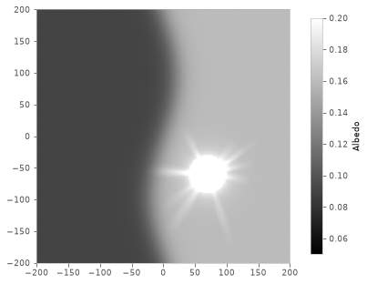

<figcaption>Dark mare meeting bright highlands, from a source of your own, with a fresh crater's rays reaching across the contact.</figcaption>

</figure>

Crater rays brighten by optical maturity, which leaves reflectance below 0.08 unchanged. Keep a source at or above that where craters should brighten it.

## Albedo layers

An albedo layer changes the albedo beneath it, one point at a time, from the value there and the point. It is laid over any albedo source with the built-in layers, in order. Here two rover wheel tracks along a winding path darken a synthetic albedo.

=== "Python"

    ```py
    --8<-- "docs/snippets/customization/write-an-albedo-layer.py:write_an_albedo_layer"
    ```

=== "C++"

    ```cpp
    --8<-- "docs/snippets/customization/write-an-albedo-layer.cpp:write_an_albedo_layer"
    ```

<figure markdown>

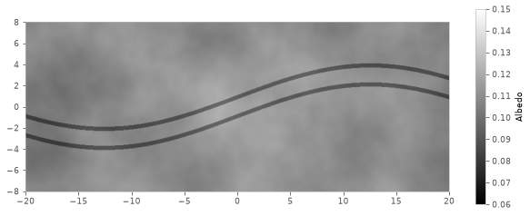

<figcaption>Rover tracks darkening a synthetic albedo on 40 m by 16 m.</figcaption>

</figure>

## Rock meshes

Boulder shapes can come from rock meshes, such as scans, in place of the procedural styles. Each boulder picks one by its shape seed, scaled to a long axis of 1 and then to its own size, and is posed, buried and settled like any other. `read_mesh` reads .obj, .gltf, .glb or .stl files, and a configuration names them as a boulder layer's `shape_files`. Here an octahedron stands in for a scanned rock.

=== "Python"

    ```py
    --8<-- "docs/snippets/customization/use-rock-meshes-for-boulders.py:use_rock_meshes_for_boulders"
    ```

=== "C++"

    ```cpp
    --8<-- "docs/snippets/customization/use-rock-meshes-for-boulders.cpp:use_rock_meshes_for_boulders"
    ```

<figure markdown>

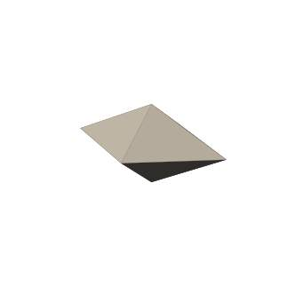

<figcaption>The rock mesh as a boulder shape.</figcaption>

</figure>

Procedural shapes can be customized too, without meshes. A boulder style names the solid a shape starts from and the ranges of its axes, fractures, noise and worn edges, as in [Design a Boulder Style of Your Own](../boulders.md#design-a-boulder-style-of-your-own).

## Rules every part follows

- **Deterministic.** A part gives the same answer for the same input every time. Anything random is drawn from a seed or from the crater's or boulder's ID, never from a shared generator, so the same seed gives the same terrain on any grid, tile or thread count.
- **A function of position.** A point gets the same height as a grid cell centered there, so terrains can be evaluated in tiles that join without seams, or queried at single points.
- **Thread-safe.** Parts are called from every evaluation thread at once, so they must not change shared state.
- **Python or C++.** Python parts are convenient for trying ideas, but they are called for every sample and Python calls take turns on the GIL, so terrains with them gain little from more threads. A C++ part runs on every thread at full speed, and is the way to go once an idea works.
