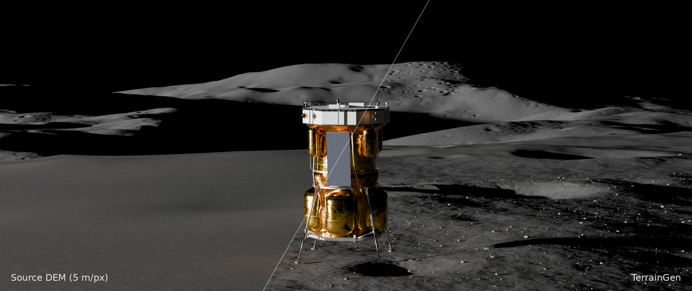

Open source &middot; C++ &middot; Python
{ .tg-hero__eyebrow }

# Scientific terrain for planetary surfaces

Craters, boulders and albedo from published models, on real elevation data or from scratch.
{ .tg-hero__lead }

[Get started](getting-started/index.md){ .md-button .md-button--primary }
[Quickstart](getting-started/quickstart.md){ .md-button }
[GitHub](https://github.com/alexmaietta/terraingen){ .md-button }
{ .tg-hero__actions }

<figure class="tg-shot" markdown>

<figcaption>Blue Moon MK1 at Connecting Ridge, near the lunar south pole. Left: the 5 m/px LOLA
elevation model. Right: the same terrain upscaled by TerrainGen.</figcaption>

</figure>

-   **Real or synthetic relief**

    ---

    Add meter-scale detail to GeoTIFF elevation models, or generate terrain from scratch, from a
    landing site to a whole body.

-   **Published crater and boulder models**

    ---

    Populations follow published size-frequency distributions; each crater gets a profile, age,
    degradation and an irregular rim.

-   **Albedo that ages**

    ---

    Synthetic albedo maps with crater ejecta and rays that fade as craters age.

-   **Geologic features**

    ---

    Secondary and complex craters, boulder ejecta, dunes and ripples, terraced strata and fractured
    bedrock.

-   **Simulation-ready outputs**

    ---

    GeoTIFF heightmaps and albedo, crater and boulder lists, and terrain and 3D boulder meshes as
    glTF, OBJ or STL.

-   **Fast and deterministic**

    ---

    Noise and crater shaping on the GPU through Vulkan, CUDA or Metal; the same seed gives the same
    terrain on any grid or thread count.

