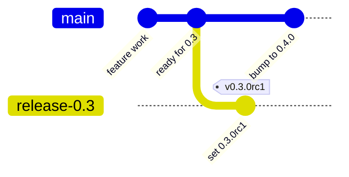
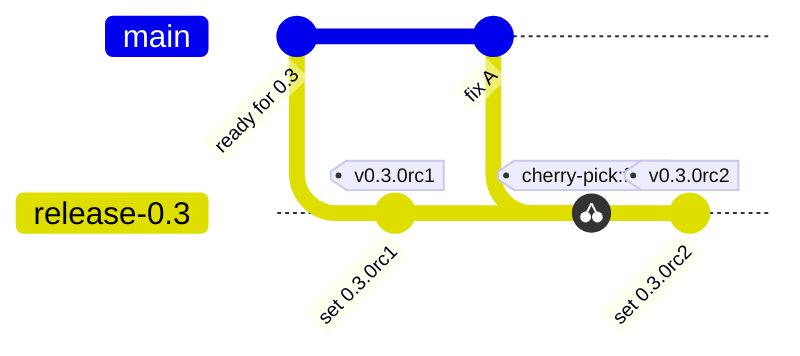
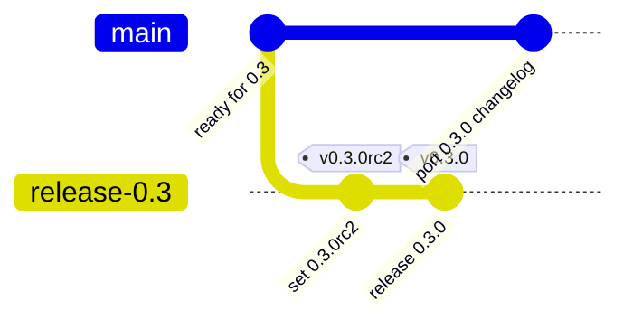
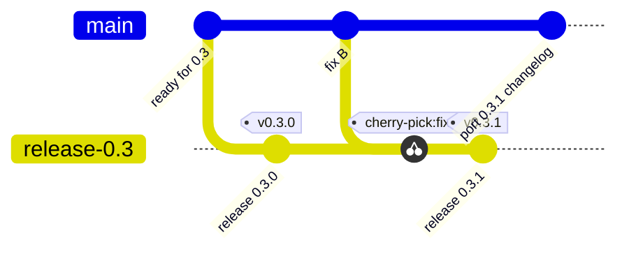
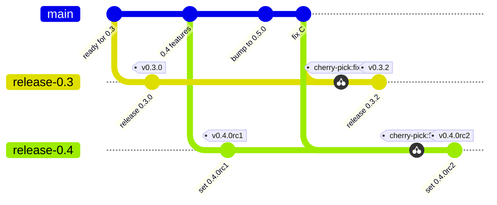

# Releases

How TerrainGen is versioned, branched, tagged and published.

## Lifecycle

1. **Cut** `release-X.Y` from `main` and bump `main` to the next minor.
2. **RC** by tagging `vX.Y.0rc1` on the release branch.
3. **Fix** on `main`, cherry-pick onto the release branch and tag the next RC.
4. **Release** by dropping the RC suffix and tagging `vX.Y.0`.
5. **Patch** with the same loop on the same branch, tagging `vX.Y.1`, `vX.Y.2` and so on.

Pushing a `v*` tag runs [release.yml](https://github.com/alexmaietta/terraingen/blob/main/.github/workflows/release.yml), which publishes the following.

| Output | RC tag `vX.Y.ZrcN` | Final tag `vX.Y.Z` |
|---|---|---|
| PyPI (`terraingenpy`) | prerelease (needs `pip install --pre`) | release |
| GitHub release | marked prerelease | release with assets and `SHA256SUMS` |
| Docker (GHCR) | `X.Y.ZrcN` | `X.Y.Z`, `X.Y`, plus `latest` if newest |
| Docs | not deployed | `X.Y/`, plus `latest` if newest |

Pushes to `main` publish only the `dev` Docker tag and the `dev/` docs with the coverage report. Nothing from `main` goes to PyPI or GitHub releases.

## Where the version lives

| File | RC tag | Final tag |
|---|---|---|
| [CMakeLists.txt](https://github.com/alexmaietta/terraingen/blob/main/CMakeLists.txt) `project(TerrainGen VERSION X.Y.Z)` | set | set |
| [CMakeLists.txt](https://github.com/alexmaietta/terraingen/blob/main/CMakeLists.txt) `TERRAINGEN_PRERELEASE` | `"rcN"` | `""` |
| [CITATION.cff](https://github.com/alexmaietta/terraingen/blob/main/CITATION.cff) `version`, `date-released` | unchanged | update |
| [README.md](https://github.com/alexmaietta/terraingen/blob/main/README.md) BibTeX `version` | unchanged | update |
| [CHANGELOG.md](https://github.com/alexmaietta/terraingen/blob/main/CHANGELOG.md) | unchanged | move `[Unreleased]` to `[X.Y.Z] - YYYY-MM-DD` |

- `CMakeLists.txt` is the source of truth. The Python package, the library's version string and the Debian packages read it.
- CI fails any tag that doesn't match `VERSION` plus `TERRAINGEN_PRERELEASE`, or that isn't on its `release-X.Y` branch.
- On `main`, `VERSION` is always the next minor with an empty `TERRAINGEN_PRERELEASE`.

## Checklist

### Cut a release branch

```bash
git switch main && git pull
git switch -c release-X.Y
# CMakeLists.txt sets VERSION X.Y.0 and TERRAINGEN_PRERELEASE "rc1"
git commit -am "Set version to X.Y.0rc1"
git push -u origin release-X.Y
```

Then commit straight to `main` to set `VERSION` to the next minor.

### Tag an RC

- [ ] Fixes are on `main` and cherry-picked with `git cherry-pick -x`
- [ ] `TERRAINGEN_PRERELEASE` bumped to `rcN`
- [ ] CI is green on `release-X.Y`
- [ ] `git tag -a vX.Y.ZrcN -m "TerrainGen X.Y.ZrcN" && git push origin vX.Y.ZrcN`
- [ ] Release workflow is green
- [ ] Smoke test with `pip install --pre terraingenpy==X.Y.ZrcN` and `docker pull ghcr.io/alexmaietta/terraingen:X.Y.ZrcN`

### Tag a final release

- [ ] Last RC tested with no changes since, apart from version metadata
- [ ] `TERRAINGEN_PRERELEASE ""` in `CMakeLists.txt`
- [ ] `CITATION.cff`, the README BibTeX and `CHANGELOG.md` updated
- [ ] CI is green on `release-X.Y`
- [ ] `git tag -a vX.Y.Z -m "TerrainGen X.Y.Z" && git push origin vX.Y.Z`
- [ ] Release workflow is green (PyPI, GitHub release, Docker, docs)
- [ ] Smoke test with `pip install terraingenpy==X.Y.Z`
- [ ] CHANGELOG, CITATION and README edits ported back to `main`

## Guidelines

- Tag only on `release-X.Y` branches, never on `main`. The release workflow fails any tag whose commit is not on its `release-X.Y` branch.
- Fix on `main` first and cherry-pick with `-x`. Commit straight to the release branch only for release-only fixes.
- Release branches take fixes only, never features.
- Use annotated tags (`git tag -a`).
- Never move or reuse a tag that reached PyPI. Ship the next version instead.
- RC numbers are cheap. When in doubt, cut another RC.
- A final tag should match the last RC apart from the version metadata.
- Keep a release branch open for as long as that minor series is supported.
- Only `main`, `release-*` and `gh-pages` branches can be created on GitHub. A repository ruleset blocks any other branch push.

## Branch model

`main` is always the next minor version. Each minor series gets a long-lived `release-X.Y` branch that only takes fixes, and every release (RC or final) is a tag on that branch.

### Cut the release branch

Branch `release-0.3` from `main`, tag the first RC, and bump `main` to `0.4.0`.



### Fix a bug found in the RC

Fix on `main`, cherry-pick, bump the RC and tag again. Repeat until an RC is clean.



### Ship the final release

Drop the RC suffix, update the changelog and citation, tag, and port those edits back to `main`.



### Patch an existing release

Same loop on the same branch. Nontrivial fixes get an RC (`v0.3.1rc1`) first.



### Start the next minor series

Cut `release-0.4` the same way. `release-0.3` stays open, and a fix that affects both is cherry-picked onto each.



## When something goes wrong after tagging

- If it failed before PyPI published, delete the tag, fix and retag the same version.
- If it failed after PyPI published, re-run the failed jobs and keep the tag.
- For a broken RC, fix and tag the next RC.
- For a broken final release, fix and ship the next patch, and yank it on PyPI if it's harmful.

To delete a tag, run the following.

```bash
git tag -d vX.Y.Z && git push origin :refs/tags/vX.Y.Z
gh release delete vX.Y.Z --yes
```

## Documentation

Each minor series gets its own copy of the docs, with a version picker in the header. CI builds them with mike and commits the built site to the `gh-pages` branch, which GitHub Pages serves. The deploy lives in [docs-deploy.yml](https://github.com/alexmaietta/terraingen/blob/main/.github/workflows/docs-deploy.yml).

- `gh-pages` holds one folder per version (`dev`, `0.3`, `0.4`) plus `latest` and a root redirect.
- Only CI writes to `gh-pages`. Don't edit it or merge it by hand.
- Doc fixes go on `main` like any other change, and get cherry-picked onto a release branch if that version's docs need them.
- A release branch's docs only redeploy with its next final tag.

| When | Docs go to |
|---|---|
| Push to `main` | `/dev/` (with coverage) |
| Final release `0.3.1` | `/0.3/` |
| RC | not deployed |

- The site root and `/latest/` always show the newest final release.
- Patching an older series never takes over `/latest/`.
- Until a release has its own docs, `/latest/` shows `dev`. Releases up to 0.2.0 predate versioned docs.
- Docker's `latest` tag works the same way.
