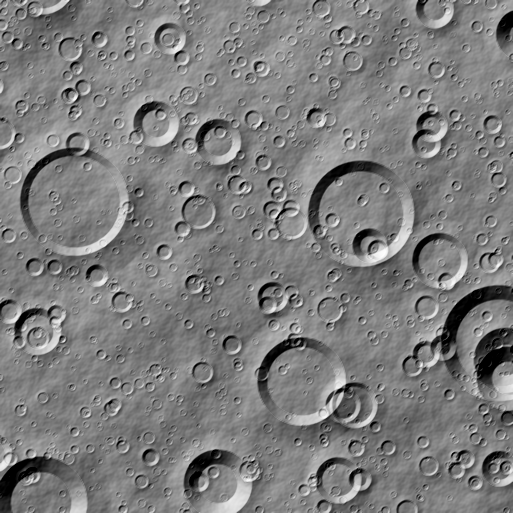

# TerrainGen

TerrainGen is an open-source suite for generating scientific terrain of planetary surfaces. It builds crater and rock populations from published size-frequency distributions, crater ages, profiles and degradation, and surface albedo, on synthetic relief or on measured elevation models, from a few metres across to whole bodies. It is a C++20 library with Python bindings and a command-line tool, made to plug into simulators and rendering pipelines. Every image below comes from one of the [examples](https://github.com/alexmaietta/terraingen/tree/main/examples).

<figure markdown>

<figcaption>Lunar crater populations at the density and ages of a 3.5 Gyr old surface. <a href="concepts/craters/">Craters</a></figcaption>
</figure>

<figure markdown>

<figcaption>Rocks from Golombek and Rapp's size model, small ones in the heights and large ones as 3D boulders. <a href="concepts/rocks/">Rocks</a></figcaption>
</figure>

<figure markdown>

<figcaption>Detail added to a coarse 16 m DEM: resampled to 2 m, with fine noise and craters below its resolution. <a href="guides/enhancing-dems/">Enhancing DEMs</a></figcaption>
</figure>

<figure markdown>

<figcaption>Albedo: bright ejecta and rays of a 2 Myr old, 4 km crater at a lunar site. <a href="concepts/albedo/">Albedo</a></figcaption>
</figure>

<figure markdown>

<figcaption>Mars: Martian crater densities, ages and shapes, with wind-blown large ripples. <a href="guides/planets/">Planets</a></figcaption>
</figure>

<figure markdown>

<figcaption>Synthetic relief from stacked noise layers: fBm, warped ridges and a roughness mask. <a href="concepts/noise/">Noise</a></figcaption>
</figure>

<figure class="wide" markdown>

<figcaption>One crater population under each degradation model, from fresh shapes to topographic diffusion. <a href="concepts/crater-profiles/">Profiles and degradation</a></figcaption>
</figure>

<figure class="wide" markdown>

<figcaption>Irregular outlines: round craters, rough rims, elongated craters and both together. <a href="concepts/crater-profiles/">Profiles and degradation</a></figcaption>
</figure>

<figure class="wide" markdown>

<figcaption>Procedural boulder shapes, each made again from its seed, for 3D rock models. <a href="concepts/rocks/">Rocks</a></figcaption>
</figure>

