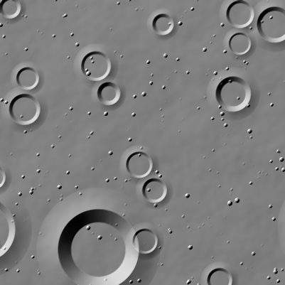
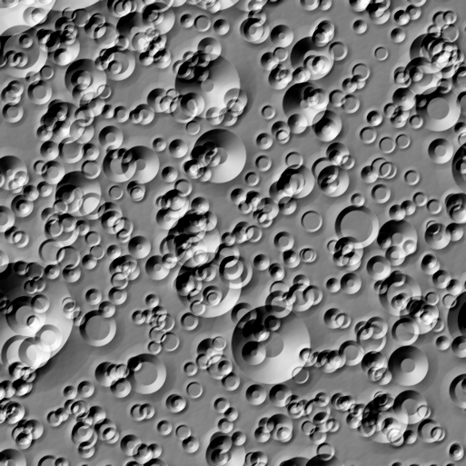
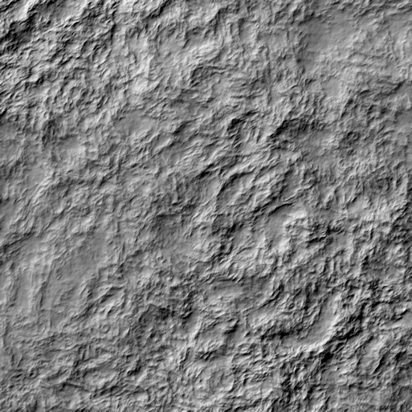
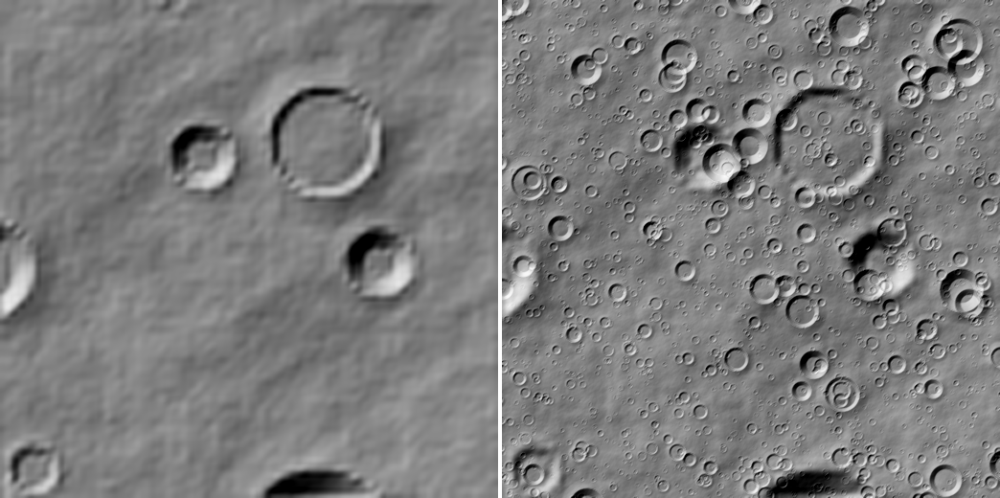
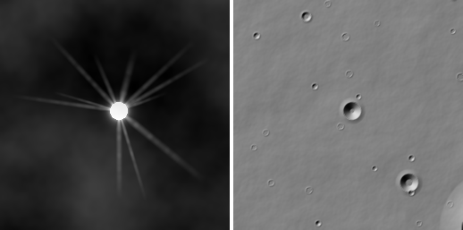
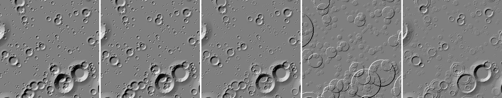
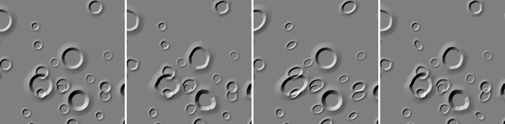
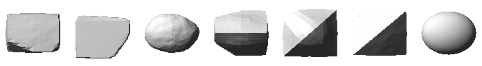

TerrainGen is an open-source suite for generating scientific terrain of planetary surfaces. It is a C++20 library with Python bindings and a command-line tool, made to plug into simulators, rendering pipelines and machine learning datasets.

-   :material-book-open-variant:{ .lg } __Grounded in the literature__

    Crater densities, ages, shapes and degradation, rock abundances and albedo come from published models, each cited in the code.

-   :material-earth:{ .lg } __From a landing site to a whole body__

    Flat grids, tiles of a sphere and whole bodies, with levels of detail that match each other.

-   :material-dice-multiple:{ .lg } __Reproducible__

    The same seed gives the same terrain on any grid, tile or number of threads.

-   :material-puzzle:{ .lg } __Made to extend__

    Sources, layers, filters, distributions, profiles and albedo are base classes to subclass in C++ or Python.

## Gallery

Every image comes from one of the [examples](https://github.com/alexmaietta/terraingen/tree/main/examples).

<figure class="tg-gallery__square" markdown>

<figcaption>Rocks from Golombek and Rapp's size model, small ones in the heights and large ones as 3D boulders. <a href="concepts/rocks/">Rocks</a></figcaption>
</figure>

<figure class="tg-gallery__square" markdown>

<figcaption>Mars: Martian crater densities, ages and shapes, with wind-blown large ripples. <a href="guides/planets/">Planets</a></figcaption>
</figure>

<figure class="tg-gallery__square" markdown>

<figcaption>Synthetic relief from stacked noise layers: fBm, warped ridges and a roughness mask. <a href="concepts/noise/">Noise</a></figcaption>
</figure>

<figure class="tg-gallery__half" markdown>

<figcaption>Detail added to a coarse 16 m DEM: resampled to 2 m, with fine noise and craters below its resolution. <a href="guides/enhancing-dems/">Enhancing DEMs</a></figcaption>
</figure>

<figure class="tg-gallery__half" markdown>

<figcaption>Albedo: bright ejecta and rays of a 2 Myr old, 4 km crater at a lunar site. <a href="concepts/albedo/">Albedo</a></figcaption>
</figure>

<figure class="tg-gallery__wide" markdown>

<figcaption>One crater population under each degradation model, from fresh shapes to topographic diffusion. <a href="concepts/crater-profiles/">Profiles and degradation</a></figcaption>
</figure>

<figure class="tg-gallery__wide" markdown>

<figcaption>Irregular outlines: round craters, rough rims, elongated craters and both together. <a href="concepts/crater-profiles/">Profiles and degradation</a></figcaption>
</figure>

<figure class="tg-gallery__wide" markdown>

<figcaption>Procedural boulder shapes, each made again from its seed, for 3D rock models. <a href="concepts/rocks/">Rocks</a></figcaption>
</figure>

